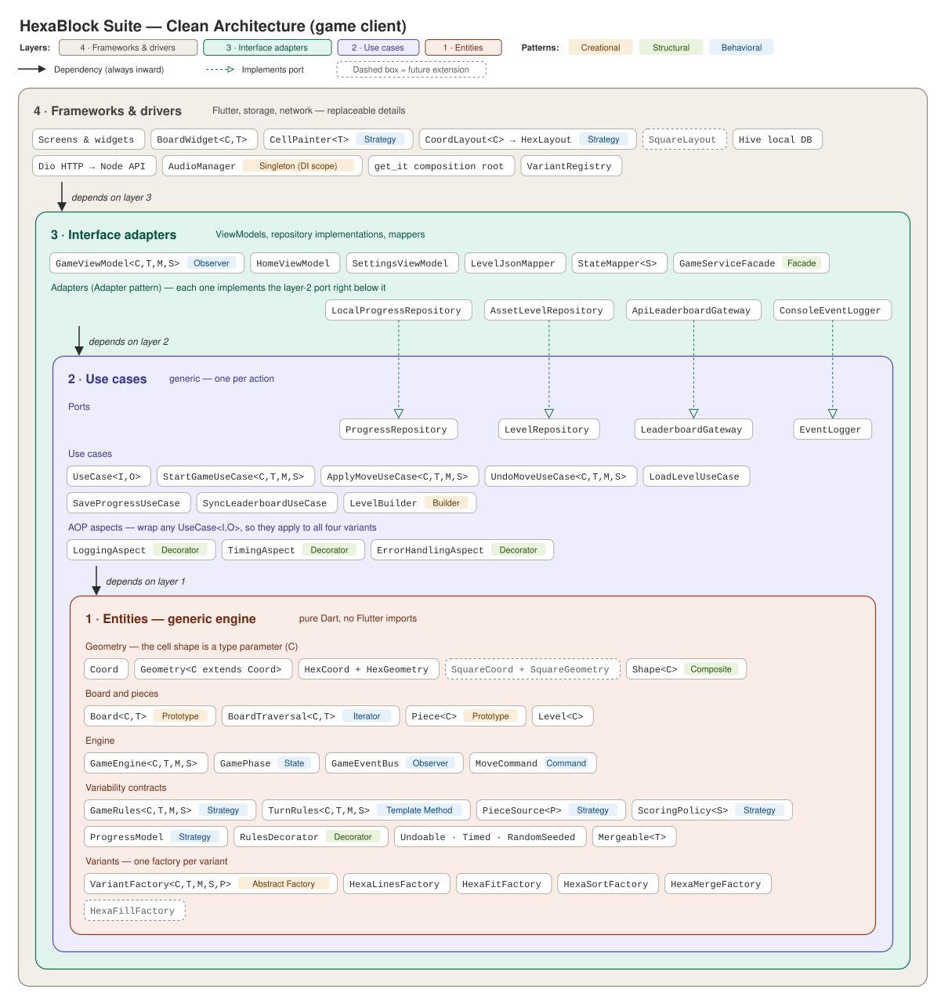
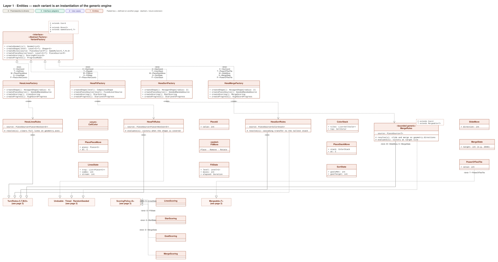

# HexaBlock Suite — Game Client

[](https://github.com/Brillem/hexablock-suite-app/actions/workflows/ci.yml)

<!-- TODO: add unit, integration and e2e test badges once those suites exist. -->

> Four games, one engine.

## Description

HexaBlock Suite is a mobile application that bundles four casual puzzle games from the HexaBlock family
(hexagonal-board puzzles) on top of a single **generic game engine**. Each variant is an instantiation of
the engine, not a copy of it, so new variants can be added without modifying existing code.

- **Tech stack:** Flutter (Dart)
- **Backend:** REST API in a separate repository (Node.js + TypeScript) — _link TBD_

## Demo / Screenshots

_TODO: screenshots or animated GIF of the four variants._

## Architecture

The project follows Robert C. Martin's **Clean Architecture**: four concentric layers where dependencies
always point inward.

| Layer | Contents |
|-------|----------|
| 1. Entities (Domain) | Generic engine: `HexBoard<TCell>`, `HexCoord`, `Piece`, `GameEngine`, variant rules, scoring policies |
| 2. Use Cases (Application) | Generic use cases and ports: `StartGameUseCase`, `ApplyMoveUseCase`, `UndoMoveUseCase`, ... |
| 3. Interface Adapters | Presenters / ViewModels, repository implementations, mappers |
| 4. Frameworks & Drivers | Flutter UI, local storage, HTTP client |



Editable source: [`docs/diagrams/clean-architecture.drawio`](docs/diagrams/clean-architecture.drawio) —
[open in diagrams.net](https://app.diagrams.net/#Uhttps%3A%2F%2Fraw.githubusercontent.com%2FBrillem%2Fhexablock-suite-app%2Fmain%2Fdocs%2Fdiagrams%2Fclean-architecture.drawio).

### Class diagram

One class diagram split into six pages, one per area. The header color shows each class's layer, stereotypes show
the design patterns, the dashed box on a class's top-right corner lists its type parameters (UML template notation),
and `«bind»` arrows show how each variant instantiates them.

| Page | Contents |
|------|----------|
| [1 · Geometry and board](docs/diagrams/class/01-domain-geometry-board.svg) | `Coord`, `Geometry<C>`, `Board<C,T>`, `Shape<C>`, `Piece<C>`, `Level<C>` |
| [2 · Engine](docs/diagrams/class/02-domain-engine.svg) | `GameEngine<C,T,M,S>`, lifecycle states, event bus, move history |
| [3 · Variability contracts](docs/diagrams/class/03-domain-contracts.svg) | `GameRules`, `TurnRules`, decorators, piece sources, scoring, progress, capabilities |
| [4 · Variants](docs/diagrams/class/04-domain-variants.svg) | `VariantFactory` and how the four variants bind the engine's type parameters |
| [5 · Use cases](docs/diagrams/class/05-application.svg) | Generic use cases, ports, AOP aspects |
| [6 · Interface adapters](docs/diagrams/class/06-adapters.svg) | ViewModels, repository adapters, mappers, facade |



Editable source: [`docs/diagrams/class-diagram.drawio`](docs/diagrams/class-diagram.drawio) —
[open in diagrams.net](https://app.diagrams.net/#Uhttps%3A%2F%2Fraw.githubusercontent.com%2FBrillem%2Fhexablock-suite-app%2Fmain%2Fdocs%2Fdiagrams%2Fclass-diagram.drawio).

## Generic Engine

_TODO: describe the engine's type parameters, their bounds and how each variant instantiates them._
See [docs/EXTENSIBILITY.md](docs/EXTENSIBILITY.md) for a step-by-step guide to adding a new variant.

## Design Patterns

| Pattern | Category | Where | Why |
|---------|----------|-------|-----|
| _TODO_ | | | |

## SOLID Principles

_TODO: one concrete example from the codebase per principle._

## AOP

_TODO: describe the implemented aspects and the SOLID-based strategy (decorators / proxies over use cases)._

## Getting Started

### Prerequisites

- Flutter SDK 3.47.9 (stable channel), the same version CI uses
- Android Studio (Android SDK) and/or Xcode (iOS) to run the app on a device or emulator

The app targets Android and iOS. Application ID: `com.hexablocksuite.hexablock_suite`.

### Installation

```bash
git clone https://github.com/Brillem/hexablock-suite-app.git
cd hexablock-suite-app
flutter pub get
flutter run
```

## Running Tests

```bash
flutter test
```

## AI Usage Documentation

AI tools are used in this project under mandatory documentation. See [AI_USAGE.md](AI_USAGE.md).

## Contributing

### Commit convention

Commit messages are written in English and follow [Conventional Commits](https://www.conventionalcommits.org/):

```text
feat(engine): add generic HexBoard with axial coordinates
fix(hexa-merge): correct slide direction on north-west axis
test(engine): add unit tests for GameEngine with fake cell type
docs(readme): add extensibility guide
```

### Branch workflow

- `main` is protected: no direct pushes, every change goes through a pull request.
- Create a branch per change: `feat/<scope>-<short-name>`, `fix/<scope>-<short-name>`, `docs/<short-name>`.
- Open a pull request to `main`, wait for CI to pass and for at least one approval, then merge.

## License

This project is licensed under the [MIT License](LICENSE).
